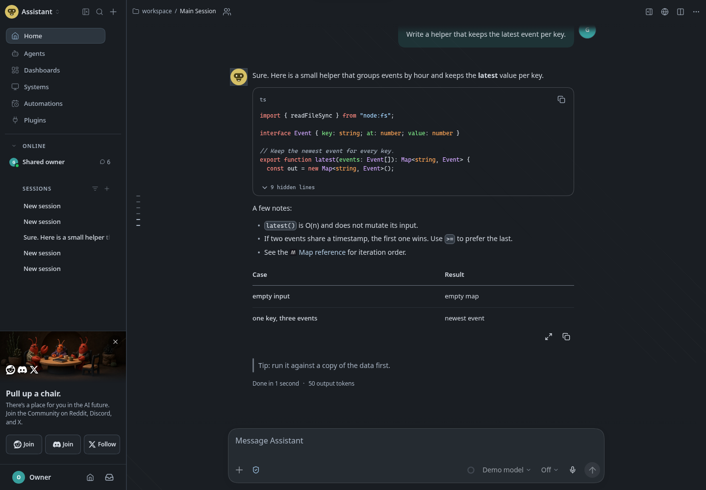

# Flatcap for OpenClaw

  

<p align="center">
  <picture>
    <source media="(prefers-color-scheme: dark)" srcset="images/screenshot-slate.png">
    <source media="(prefers-color-scheme: light)" srcset="images/screenshot-daylight.png">
    
  </picture>
</p>

<p align="center"><sub>Slate or Daylight is shown to match your GitHub appearance.</sub></p>

**Flatcap for OpenClaw** brings the Flatcap visual system to the OpenClaw Control UI: matte graphite surfaces, one mineral-blue accent, IBM Plex Sans for the interface and the conversation, Cascadia for code.

> The interface organizes. Content takes the foreground. Color informs.

It is a declarative theme plugin. It appears next to the built-in themes in **Settings → Appearance**, with two independently tuned modes, **Slate** (dark) and **Daylight** (light), that follow the Control UI's color-mode setting.

## Quiet precision

[Flatcap](https://github.com/cheycron/flatcap-theme) is a semantic visual system for focused work. Colors are named for **what they do**, not for how they look, and the two modes share roles rather than identical values: Daylight is not an inverted Slate.

- **Hierarchy before decoration.** Surfaces separate by tone and hairline borders; menus and dialogs are the only floating layer.
- **Useful color.** Mineral blue marks interaction and the current item; red appears only for destructive actions and errors.
- **Explicit interaction.** Focus rings, field outlines and the primary action stay clearly visible in both modes.
- **Calm by default.** No mascot, no Lobsterdex and no whimsical status phrases: the working indicator is three quiet dots.

## What is in the box

| File                           | What it is                                                        |
|:------------------------------ |:----------------------------------------------------------------- |
| `openclaw.plugin.json`         | Plugin manifest. Declares the theme `flatcap/flatcap`.            |
| `themes/flatcap.json`          | The theme: Slate and Daylight palettes, fonts and presentation.   |
| `assets/theme-art/flatcap.svg` | The Flatcap cap, used as the brand icon in the Control UI.        |
| `index.js`                     | Empty entry point. OpenClaw needs one to discover the plugin.     |

The plugin runs no code, adds no tools and needs no configuration.

## Install

Requires **OpenClaw 2026.10.9** or newer. Pick one source:

```sh
openclaw plugins install clawhub:@cheycron/flatcap-openclaw   # ClawHub (recommended)
openclaw plugins install npm:@cheycron/flatcap-openclaw       # npm
openclaw plugins install git:github.com/cheycron/flatcap-openclaw   # this repository
```

Installing enables the plugin, and the theme becomes available right away; no Gateway restart is needed. To install a local checkout, pass its path instead (`-l` links it while you develop).

## Use it

1. Open **Settings → Appearance**.
2. Under **Theme**, choose **Flatcap**.
3. Set the color mode: **Dark** uses Slate, **Light** uses Daylight, and **System** follows your operating system.

You can also ask your agent: *"Switch my theme to Flatcap."* The agent's theme tool uses the ID `flatcap/flatcap`.

To go back, pick another theme. Uninstalling or disabling the plugin returns you to the default theme.

## Presentation

| Field              | Value                  | Why                                                           |
|:------------------ |:---------------------- |:------------------------------------------------------------- |
| `mascot`           | `none`                 | The lobster does not fit a quiet interface.                   |
| `brandIcon`        | `flatcap`              | The Flatcap cap replaces the claw mark.                       |
| `workingIndicator` | `dots`                 | A neutral, non-decorative progress signal.                    |
| `workingPhrases`   | none                   | Long waits are shown without status jokes.                    |
| `lobsterdex`       | hidden                 | Hiding it does not delete your collection.                    |
| `brandName`        | not set                | The product is still called OpenClaw.                         |

The community links and the "Pull up a chair" card are left at OpenClaw's default.

## Fonts

- **Interface and conversation:** IBM Plex Sans, which ships with the Control UI.
- **Code, logs and IDs:** Cascadia Mono, falling back to Cascadia Code, `ui-monospace` and Consolas.

Themes cannot load fonts from the network. Cascadia is not bundled; install it on the devices you use for the intended look. Layout and colors are unaffected without it.

## Mapping: Flatcap roles to OpenClaw tokens

Each OpenClaw token is mapped by intent from the Flatcap roles, never by order.

<!-- build:tokens:start -->
| OpenClaw token | Flatcap role | Slate (dark) | Daylight (light) | Used for |
| :--- | :--- | :--- | :--- | :--- |
| `background` | `bg.canvas` | `#191D22` | `#F3F5F7` | App canvas behind everything. |
| `foreground` | `text.primary` | `#D5DBE3` | `#28313B` | Chat text, headings, default ink. |
| `card` | `bg.surface` | `#20252B` | `#FAFBFC` | Panels, message cards, form fields. |
| `card-foreground` | `text.primary` | `#D5DBE3` | `#28313B` | Ink on cards. |
| `popover` | `bg.raised` | `#292F36` | `#FFFFFF` | Menus, dialogs, hover cards: the only floating surfaces. |
| `popover-foreground` | `text.primary` | `#D5DBE3` | `#28313B` | Ink on popovers. |
| `primary` | `accent.fill` | `#9BBFDF` | `#285D85` | Primary action: Send, confirm. |
| `primary-foreground` | `accent.on` | `#101820` | `#FAFBFC` | Label on the primary action; never assumed white. |
| `secondary` | `bg.hover` | `#323A43` | `#E6EBF0` | Quiet neutral fills: avatars, table heads, diff rows. |
| `secondary-foreground` | `text.secondary` | `#AEB8C4` | `#465463` | Secondary ink on those fills. |
| `muted` | `bg.hover` | `#323A43` | `#E6EBF0` | Recessed fills: inline code, code blocks, switches; also the base of hover tints. |
| `muted-foreground` | `text.muted` | `#A7B3C2` | `#536273` | Metadata, timestamps, help text. |
| `accent` | `accent.fg` | `#9BBFDF` | `#285D85` | Links, current item, accent marks and tints. |
| `accent-foreground` | `accent.on` | `#101820` | `#FAFBFC` | Ink on solid accent fills. |
| `destructive` | `danger.fg` | `#E2A0A5` | `#A43F4A` | Destructive actions and error ink. |
| `destructive-foreground` | `danger.bg` | `#382A30` | `#F5E5E7` | Label on a solid destructive fill (the feedback pair, reversed). |
| `border` | `border.subtle` | `#3D4652` | `#D2D9E0` | Separators and panel edges (decorative). |
| `input` | `border.control` | `#8593A5` | `#6C7A89` | Outline that identifies a field or control. |
| `ring` | `focus.ring` | `#B0D2F0` | `#285D85` | Keyboard focus. |
| `font-sans` | `font.ui` | `"IBM Plex Sans", "Segoe UI", system-ui, sans-serif` | same | Interface and reading. |
| `font-mono` | `font.literal` | `"Cascadia Mono", "Cascadia Mono NF", "Cascadia Code", ui-monospace, Consolas, monospace` | same | Code, logs, IDs: one shared literal slot. |
<!-- build:tokens:end -->

## Accessibility

Contrast is computed from the palette by `scripts/build.py` (WCAG 2.x), and the build fails if any pair misses its target: 7:1 for body text, 5:1 for secondary text, links and errors, 3:1 for outlines and focus.

<!-- build:contrast:start -->
| Foreground | Background | Target | Slate | Daylight |
| :--- | :--- | ---: | ---: | ---: |
| `foreground` | `background` | 7:1 | 12.15:1 | 12.06:1 |
| `foreground` | `card` | 7:1 | 11.07:1 | 12.73:1 |
| `foreground` | `popover` | 7:1 | 9.70:1 | 13.19:1 |
| `foreground` | `muted` | 7:1 | 8.27:1 | 10.99:1 |
| `foreground` | `secondary` | 7:1 | 8.27:1 | 10.99:1 |
| `card-foreground` | `card` | 7:1 | 11.07:1 | 12.73:1 |
| `popover-foreground` | `popover` | 7:1 | 9.70:1 | 13.19:1 |
| `secondary-foreground` | `secondary` | 5:1 | 5.74:1 | 6.46:1 |
| `muted-foreground` | `background` | 5:1 | 7.96:1 | 5.71:1 |
| `muted-foreground` | `card` | 5:1 | 7.25:1 | 6.03:1 |
| `muted-foreground` | `popover` | 5:1 | 6.35:1 | 6.25:1 |
| `muted-foreground` | `muted` | 5:1 | 5.42:1 | 5.21:1 |
| `muted-foreground` | `secondary` | 5:1 | 5.42:1 | 5.21:1 |
| `primary-foreground` | `primary` | 4.5:1 | 9.30:1 | 6.77:1 |
| `accent-foreground` | `accent` | 4.5:1 | 9.30:1 | 6.77:1 |
| `destructive-foreground` | `destructive` | 4.5:1 | 6.36:1 | 5.09:1 |
| `accent` | `background` | 5:1 | 8.80:1 | 6.42:1 |
| `accent` | `card` | 5:1 | 8.02:1 | 6.77:1 |
| `accent` | `popover` | 5:1 | 7.02:1 | 7.01:1 |
| `accent` | `muted` | 5:1 | 5.99:1 | 5.85:1 |
| `accent` | `secondary` | 5:1 | 5.99:1 | 5.85:1 |
| `destructive` | `background` | 5:1 | 7.91:1 | 5.67:1 |
| `destructive` | `card` | 5:1 | 7.20:1 | 5.98:1 |
| `destructive` | `popover` | 5:1 | 6.31:1 | 6.20:1 |
| `primary` | `background` | 3:1 | 8.80:1 | 6.42:1 |
| `primary` | `card` | 3:1 | 8.02:1 | 6.77:1 |
| `primary` | `popover` | 3:1 | 7.02:1 | 7.01:1 |
| `ring` | `background` | 3:1 | 10.74:1 | 6.42:1 |
| `ring` | `card` | 3:1 | 9.79:1 | 6.77:1 |
| `ring` | `popover` | 3:1 | 8.57:1 | 7.01:1 |
| `input` | `background` | 3:1 | 5.41:1 | 4.02:1 |
| `input` | `card` | 3:1 | 4.93:1 | 4.24:1 |
| `input` | `popover` | 3:1 | 4.32:1 | 4.39:1 |
| `text.primary` | `bg.selected` | 7:1 | 7.95:1 | 10.68:1 |
| `text.muted` | `bg.selected` | 5:1 | 5.20:1 | 5.06:1 |
| `accent-foreground` | `accent-hover (host-derived)` | 4.5:1 | 10.61:1 | 8.74:1 |
| `accent-hover (host-derived)` | `background` | 3:1 | 10.04:1 | 8.28:1 |
<!-- build:contrast:end -->

The rendered interface was also sampled in both modes (body text, sidebar, links, inline code, blockquotes); everything met AA, from 5.71:1 to 12.15:1.

Known limits: OpenClaw reuses the field-outline color as a fill in a few controls, such as the session-settings search, and those spots were not measured one by one. Hover and focus states of menus and dialogs were not captured.

## Compatibility

- **OpenClaw 2026.10.9** or newer, the version it was tested with. Theme plugins exist since 2026.9.6, but the presentation fields it uses are only documented for 2026.10.9.
- Rendering was checked in Chromium. Other browsers are not tested.
- `openclaw plugins validate` reports that the entry exposes no tool or feature metadata. That check targets tool plugins; a theme has none. ClawHub's plugin inspector passes with no findings.

## How it is built

`themes/flatcap.json` and the two tables above are generated; do not edit them by hand.

- `src/theme.json` holds the Flatcap 2.0 values. It is a copy of the core, as is `src/logo.svg`.
- `scripts/build.py` maps the roles to OpenClaw tokens, checks the size limit (4096 bytes per definition), the token set and contrast, and writes the theme. It needs Python 3.10+ and nothing else.

```sh
python3 scripts/build.py            # regenerate the theme and the README tables
python3 scripts/build.py --check    # fail if generated files are out of date
python3 scripts/build.py --sync     # refresh src/ from ../00-Flatcap, then rebuild
python3 scripts/build.py --contrast # print contrast ratios
```

`--sync` expects the core checkout next to this repository (`../00-Flatcap`); pass a path to use another one.

Colors come from [Flatcap](https://github.com/cheycron/flatcap-theme), the core of the system.

## License

MIT. Fonts are not bundled and carry their own licenses. The cap drawing derives from third-party artwork (Vexels, [terms](https://vexels.com/terms-and-conditions/)) and is not relicensed by MIT.

## Support

If Flatcap makes your workspace calmer, you can support its development.

<p align="center">
  <a href="https://www.buymeacoffee.com/cheycron">
    
  </a>
</p>
