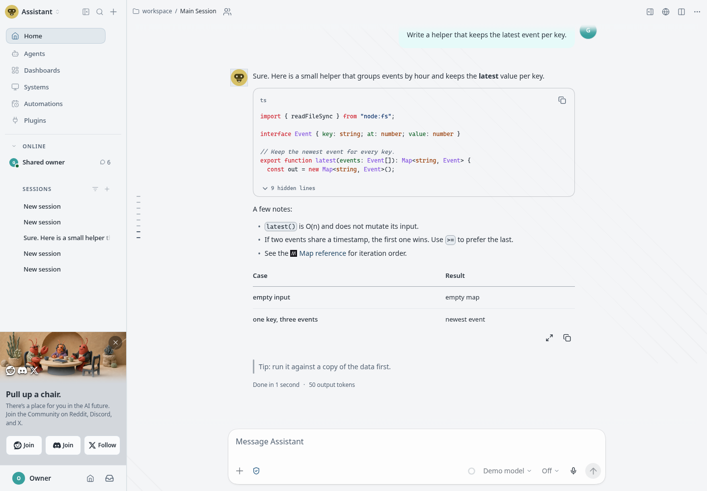

# Flatcap for OpenClaw

   [](https://clawhub.ai/cheycron/plugins/flatcap-openclaw)

<p align="center">
  
</p>

<p align="center">
  
</p>

<p align="center"><sub>Flatcap Slate (dark) above, Flatcap Daylight (light) below.</sub></p>

**Flatcap for OpenClaw** brings the Flatcap visual system to the OpenClaw Control UI: matte graphite surfaces, one mineral-blue accent, IBM Plex Sans for the interface and the conversation, Cascadia for code.

It is a declarative theme plugin with two independently tuned modes, **Slate** (dark) and **Daylight** (light). It runs no code, adds no tools and needs no configuration.

> The interface organizes. Content takes the foreground. Color informs.

## Install

Requires **OpenClaw 2026.10.9** or newer. Install it from ClawHub or straight from this repository:

```sh
openclaw plugins install clawhub:@cheycron/flatcap-openclaw   # ClawHub (recommended)
openclaw plugins install git:github.com/cheycron/flatcap-openclaw   # this repository
```

Installing enables the plugin, and the theme becomes available right away; no Gateway restart is needed. To install a local checkout, pass its path instead (`-l` links it while you develop).

## Use it

1. Open **Settings → Appearance**.
2. Under **Theme**, choose **Flatcap**.
3. Set the color mode: **Dark** uses Slate, **Light** uses Daylight, and **System** follows your operating system.

You can also ask your agent: *"Switch my theme to Flatcap."* The agent's theme tool uses the ID `flatcap/flatcap`.

The theme also quiets the interface: no mascot, the Flatcap cap as brand icon, three plain dots as the working indicator, no status phrases, and the Lobsterdex hidden (your collection is not deleted). To go back, pick another theme; uninstalling or disabling the plugin returns you to the default.

## Fonts

- **Interface and conversation:** IBM Plex Sans, which ships with the Control UI.
- **Code, logs and IDs:** Cascadia Mono, falling back to Cascadia Code, `ui-monospace` and Consolas.

Themes cannot load fonts from the network, so Cascadia is not bundled: install it on the devices you use for the intended look. Layout and colors are unaffected without it. See the [Flatcap typography guide](https://github.com/cheycron/flatcap-theme/blob/main/docs/typography.md).

## Accessibility

Contrast is computed from the palette against the contracts of the [Flatcap core](https://github.com/cheycron/flatcap-theme) (WCAG 2.x), and `python3 scripts/build.py --check` fails if any pair misses its target: 7:1 for body text, 5:1 for secondary text, links and errors, 3:1 for outlines and focus. The rendered interface was also sampled in both modes and met AA everywhere (5.71:1 to 12.15:1).

Limits that affect you: OpenClaw reuses the field-outline color as a fill in a few controls, such as the session-settings search, and those spots were not measured one by one. Hover and focus states of menus and dialogs were not captured.

The token mapping and the contrast table are in the [full mapping](https://github.com/cheycron/flatcap-openclaw/blob/main/docs/mapping.md).

## Compatibility

- **OpenClaw 2026.10.9** or newer, the version it was tested with. Theme plugins exist since 2026.9.6, but the presentation fields it uses are only documented for 2026.10.9.
- Rendering was checked in Chromium. Other browsers are not tested.
- `openclaw plugins validate` reports that the entry exposes no tool or feature metadata. That check targets tool plugins; a theme has none. ClawHub's plugin inspector passes with no findings.

## Contributing

`themes/flatcap.json` is generated from `src/theme.json`; do not edit it by hand. Run `python3 scripts/build.py --check` before opening a pull request. Mapping details are in [docs/mapping.md](https://github.com/cheycron/flatcap-openclaw/blob/main/docs/mapping.md).

## License

MIT © Cheycron Blaine. See [LICENSE](https://github.com/cheycron/flatcap-openclaw/blob/main/LICENSE). The cap drawing derives from third-party artwork (Vexels, [terms](https://vexels.com/terms-and-conditions/)) and is not relicensed by MIT.

## Support

If Flatcap makes your workspace calmer, you can support its development.

<p align="center">
  <a href="https://www.buymeacoffee.com/cheycron">
    
  </a>
</p>
